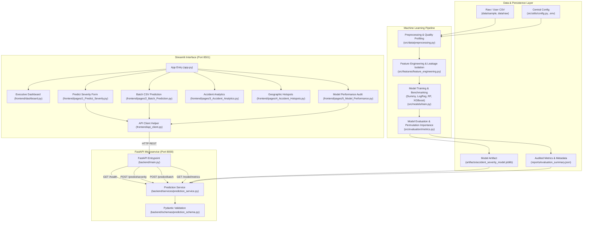

# 🛡️ RoadGuard AI: AI-Powered Road Accident Severity Prediction & Risk Analytics System

> **"Understand Risk. Improve Road Safety."**  
> An end-to-end, production-grade Machine Learning and Web Intelligence platform for predicting collision severity, diagnosing infrastructure and environmental risk factors, and delivering interactive geospatial safety analytics.

---

## 1. Project Overview

**RoadGuard AI** is an intermediate-to-advanced machine learning and full-stack AI application designed to model historical collision dynamics, quantify accident severity risk tiers (**Slight**, **Serious**, **Fatal**), and expose actionable safety insights.

The platform bridges empirical data science and software engineering by providing:
1. **Automated ML Training & Selection Pipeline**: Benchmark multiple algorithms (Dummy Baseline, Logistic Regression, Random Forest, XGBoost) using Scikit-Learn pipelines, with automatic model selection driven by Macro-F1 and Balanced Accuracy to properly handle severe class imbalance.
2. **Leakage-Free Preprocessing**: Rigid isolation of pre-incident circumstances (weather, lighting, carriageway type, speed limit) from post-incident outcomes (casualty counts, emergency attendance).
3. **High-Performance FastAPI Microservice**: Asynchronous backend serving real-time prediction, validation, and batch CSV inference endpoints.
4. **Interactive Streamlit Web Dashboard**: Executive multi-page analytics interface featuring real-time risk assessment, batch prediction exports, historical correlation analysis, hotspot mapping, and model governance reports.

---

## 2. Problem Statement & Objectives

Road traffic collisions represent one of the leading global causes of preventable trauma and infrastructure economic loss. Traditional traffic safety reports are often static, retrospective, and unintegrated into decision-support systems.

### Core Objectives
* **Pre-Collision Severity Estimation**: Predict collision outcome severity based strictly on environmental conditions, roadway layout, and vehicle counts available at collision assessment time.
* **Explainability & Risk Factor Audit**: Use Permutation Importance and feature attribution to evaluate which infrastructural parameters correlate most strongly with fatal and serious crashes.
* **Batch Analytics & Export**: Empower traffic safety auditors to run batch collision logs through ML pipelines and download enriched risk datasets.
* **Transparent Governance**: Adhere to responsible AI standards by communicating confidence intervals, model limitations, and baseline comparisons.

---

## 3. Technology Stack

| Layer | Technologies |
|---|---|
| **Language** | Python 3.11 / 3.12 |
| **Data Processing & ML** | Pandas, NumPy, Scikit-learn, XGBoost, Joblib |
| **Model Evaluation** | Accuracy, Balanced Accuracy, Precision, Recall, Macro/Weighted F1, Permutation Importance |
| **Backend REST API** | FastAPI, Uvicorn, Pydantic v2, Python-Multipart |
| **Frontend Dashboard** | Streamlit, Requests, Plotly Express |
| **Geospatial Analytics** | Plotly Mapbox / Scatter Map (using validated geographical coordinates) |
| **Configuration & Quality** | Python-dotenv, Pytest, HTTPX, FastAPI TestClient |
| **Persistence** | CSV (datasets/reports), JSON (metadata/metrics), Joblib (fitted pipelines) — *No SQL/NoSQL database dependency* |

---

## 4. System Architecture



---

## 5. Project Folder Structure

```
road-accident-severity-prediction/
├── app.py                             # Streamlit main entrypoint & navigation
├── requirements.txt                   # Production dependencies
├── README.md                          # Comprehensive project documentation
├── .gitignore                         # Git exclusion rules
├── .env.example                       # Template environment configuration
├── .env                              # Active local configuration
├── pytest.ini                         # Pytest root configuration
│
├── data/
│   ├── raw/                           # Raw external dataset staging
│   ├── processed/                     # Preprocessed data outputs
│   └── sample/
│       └── sample_accidents.csv       # 3,000-record benchmark historical dataset
│
├── notebooks/
│   ├── 01_data_exploration.ipynb      # EDA and distribution analysis
│   ├── 02_data_cleaning.ipynb         # Missing values & validation profiling
│   ├── 03_feature_engineering.ipynb   # Temporal extraction & schema alignment
│   └── 04_model_training.ipynb        # Multi-model benchmarking & evaluation
│
├── src/
│   ├── data/
│   │   └── preprocessing.py           # Data loading, validation, and ColumnTransformers
│   ├── features/
│   │   └── feature_engineering.py     # Leakage isolation and attribute extraction
│   ├── models/
│   │   ├── train.py                   # Model comparison, training, and artifact persistence
│   │   └── predict.py                 # Core inference engine for single & batch predictions
│   ├── evaluation/
│   │   └── metrics.py                 # Multi-class metrics and permutation feature importance
│   └── utils/
│       └── config.py                  # Centralized configuration, paths, and schemas
│
├── artifacts/
│   ├── accident_severity_model.joblib # Serialized best-performing ML pipeline
│   └── model_metadata.json            # Model training metadata & algorithm specs
│
├── backend/
│   ├── main.py                        # FastAPI endpoints and route handlers
│   ├── schemas/
│   │   └── prediction_schema.py       # Pydantic request & response schemas
│   └── services/
│       └── prediction_service.py      # Business logic & batch streaming service
│
├── frontend/
│   ├── dashboard.py                   # Executive KPI & historical overview
│   ├── api_client.py                  # Centralized HTTP client communicating with FastAPI
│   └── pages/
│       ├── 1_Predict_Severity.py      # Single collision prediction form
│       ├── 2_Batch_Prediction.py      # CSV upload, prediction & export
│       ├── 3_Accident_Analytics.py    # Multi-filter interactive charts
│       ├── 4_Accident_Hotspots.py     # Hotspot map with verified coordinates
│       └── 5_Model_Performance.py    # Audited validation metrics & feature ranking
│
├── tests/
│   ├── test_preprocessing.py          # 9 unit tests for data integrity & leakage prevention
│   ├── test_prediction.py             # 6 tests for inference engine and schema enforcement
│   └── test_api.py                    # 7 integration tests for FastAPI REST endpoints
│
└── reports/
    ├── evaluation_summary.json        # Comprehensive evaluation audit report
    └── model_comparison.csv           # Benchmark scores for all candidate algorithms
```

---

## 6. Dataset Schema & Data Leakage Prevention

### Expected Dataset Schema

| Column | Type | Permitted Values / Description | Role in System |
|---|---|---|---|
| `accident_severity` | Categorical | `Slight`, `Serious`, `Fatal` | **Target Variable** |
| `number_of_vehicles` | Integer | $\ge 1$ (e.g. 1 to 5) | Feature |
| `speed_limit` | Integer | 20, 30, 40, 50, 60, 70 (mph) | Feature |
| `accident_hour` / `accident_time` | Int / String | 0 to 23 or `HH:MM` | Feature (Derived) |
| `day_of_week` | Categorical | `Monday` through `Sunday` | Feature |
| `road_type` | Categorical | `Single carriageway`, `Dual carriageway`, `Roundabout`, `One way street`, `Slip road` | Feature |
| `road_surface_conditions` | Categorical | `Dry`, `Wet or damp`, `Snow`, `Frost or ice`, `Flood` | Feature |
| `weather_conditions` | Categorical | `Fine no high winds`, `Raining no high winds`, `Raining + high winds`, `Fog or mist`, etc. | Feature |
| `light_conditions` | Categorical | `Daylight`, `Darkness - lights lit`, `Darkness - lights unlit`, `Darkness - no lighting` | Feature |
| `urban_or_rural_area` | Categorical | `Urban`, `Rural` | Feature |
| `junction_detail` | Categorical | `Not at junction`, `T or staggered junction`, `Crossroads`, `Roundabout`, etc. | Feature |
| `latitude` | Float | [-90.0, 90.0] | Geospatial Visualization Only |
| `longitude` | Float | [-180.0, 180.0] | Geospatial Visualization Only |
| `number_of_casualties` | Integer | Historical post-incident count | **Omitted (Leakage Prevention)** |
| `accident_id` | String | Unique identifier | **Omitted (Overfitting Prevention)** |

### Data Leakage Prevention Policy
1. **Post-Outcome Information**: Features like `number_of_casualties`, `casualty_severity`, or `hospital_admissions` are recorded *after* an accident has concluded. They are strictly stripped out of model training matrices (`X_train`, `X_test`).
2. **Identifier Isolation**: Record IDs, arbitrary row indices, and timestamp strings are purged from estimator inputs.
3. **Train-Test Boundary Integrity**: Imputers (median/mode) and One-Hot encoders are fit **strictly** on `X_train` and transform `X_test` / live inputs without cross-contamination.

---

## 7. Model Training & Measured Benchmark Results

Candidate models were trained on 80% (2,400 samples) and evaluated on a held-out 20% test split (600 samples) using stratified sampling.

### Actual Measured Model Comparison (`reports/model_comparison.csv`)

| Candidate Algorithm | Accuracy | Balanced Accuracy | Macro Precision | Macro Recall | Macro F1-Score | Weighted F1 |
|---|---|---|---|---|---|---|
| 🏆 **Random Forest (Selected)** | **0.7217** | **0.6455** | **0.6087** | **0.6455** | **0.6236** | **0.7289** |
| 🥈 **Logistic Regression** | 0.7017 | 0.6786 | 0.5923 | 0.6786 | 0.6178 | 0.7122 |
| 🥉 **XGBoost Classifier** | 0.7300 | 0.5827 | 0.6287 | 0.5827 | 0.6002 | 0.7250 |
| ⛔ **Dummy Baseline** | 0.5367 | 0.3674 | 0.3679 | 0.3674 | 0.3676 | 0.5345 |

### Selection Criterion Rationale
In real-world collision data, **Fatal** and **Serious** accidents represent a critical minority (~7% and ~29% respectively in benchmark statistics). Simple accuracy is heavily distorted by predicting the majority **Slight** class.
The pipeline automatically selects **Random Forest** because it yields the highest **Macro F1-Score (0.6236)** and strong **Balanced Accuracy (0.6455)**, ensuring equitable sensitivity across severe injury categories.

### Top Predictive Factors (Permutation Importance on Test Set)
1. **Speed Limit** ($\Delta \text{F1} = +0.206$): The strongest determinant distinguishing fatal and serious collisions from minor crashes.
2. **Urban or Rural Area** ($\Delta \text{F1} = +0.067$): Rural roadways correlate with higher impact speeds and delayed medical access.
3. **Lighting Conditions** ($\Delta \text{F1} = +0.047$): Unlit rural darkness significantly elevates collision severity probabilities.
4. **Weather Conditions** ($\Delta \text{F1} = +0.022$): Severe wind and rain amplify stopping distance risks.
5. **Number of Vehicles** ($\Delta \text{F1} = +0.014$): Multi-vehicle pileups correlate with higher severe injury rates.

*Disclaimer: Statistical permutation importance reflects predictive association in the historical sample, not certified legal liability or mechanical causality.*

---

## 8. Installation & Setup Instructions

### Prerequisites
* Python 3.11 or 3.12
* Git

### Step 1: Clone Repository & Create Virtual Environment
```bash
git clone https://github.com/yourusername/road-accident-severity-prediction.git
cd road-accident-severity-prediction

# Create virtual environment
python -m venv venv

# Activate virtual environment
# Windows (PowerShell):
.\venv\Scripts\Activate.ps1
# Linux / macOS:
source venv/bin/activate
```

### Step 2: Install Dependencies
```bash
pip install -r requirements.txt
```

### Step 3: Configure Environment Variables
Copy `.env.example` to `.env`:
```bash
cp .env.example .env
```
Default parameters are pre-configured for local execution.

---

## 9. Execution Guide

### 1. Train the ML Models & Generate Artifacts
Run the end-to-end training pipeline to benchmark algorithms and export models:
```bash
python -m src.models.train
```
This regenerates:
* `artifacts/accident_severity_model.joblib`
* `artifacts/model_metadata.json`
* `reports/evaluation_summary.json`
* `reports/model_comparison.csv`

### 2. Start the FastAPI Backend
Launch the high-performance prediction microservice:
```bash
uvicorn backend.main:app --host 127.0.0.1 --port 8000 --reload
```
Interactive API documentation will be accessible at:
* Swagger UI: [http://127.0.0.1:8000/docs](http://127.0.0.1:8000/docs)
* ReDoc: [http://127.0.0.1:8000/redoc](http://127.0.0.1:8000/redoc)

### 3. Start the Streamlit Analytics Dashboard
In a separate terminal, launch the Streamlit frontend:
```bash
streamlit run app.py
```
Open your browser at [http://localhost:8501](http://localhost:8501).

---

## 10. API Endpoint Reference

### `GET /`
Returns application metadata, version, and documentation link.

### `GET /health`
Returns operational readiness of the API and status of the loaded model pipeline.
```json
{
  "status": "healthy",
  "app_name": "RoadGuard AI",
  "version": "1.0.0",
  "model_loaded": true,
  "model_name": "Random Forest",
  "prediction_ready": true,
  "details": "Model pipeline is ready for inference."
}
```

### `POST /predict/severity`
Executes real-time single collision severity prediction.

#### Example Request Payload:
```json
{
  "number_of_vehicles": 2,
  "speed_limit": 60,
  "accident_hour": 23,
  "day_of_week": "Saturday",
  "road_type": "Dual carriageway",
  "road_surface_conditions": "Wet or damp",
  "weather_conditions": "Raining + high winds",
  "light_conditions": "Darkness - no lighting",
  "urban_or_rural_area": "Rural",
  "junction_detail": "Not at junction"
}
```

#### Example Response:
```json
{
  "status": "success",
  "predicted_severity": "Fatal",
  "confidence": 0.6382,
  "class_probabilities": {
    "Fatal": 0.6382,
    "Serious": 0.3299,
    "Slight": 0.0319
  },
  "model_identifier": "Random Forest",
  "disclaimer": "RoadGuard AI provides statistical severity estimates based on historical accident patterns..."
}
```

### `POST /predict/batch`
Accepts a `.csv` upload with collision records, validates inputs, and streams back an enriched CSV containing `predicted_severity` and `class_probabilities`.

### `GET /model/metrics`
Returns audited test-set metrics, algorithm comparison table, and permutation feature rankings.

---

## 11. Automated Testing

The project includes an automated test suite across preprocessing, inference, and REST endpoints:

```bash
pytest -v
```

### Test Coverage Highlights
* `tests/test_preprocessing.py`: Validates CSV ingestion, empty dataset rejection, target leakage prevention, missing feature fallbacks, and schema enforcement.
* `tests/test_prediction.py`: Tests single prediction schema consistency, batch inference, numerical bounds validation, and missing artifact exceptions.
* `tests/test_api.py`: Validates FastAPI root, health, single prediction, invalid input (422), batch CSV streaming, non-CSV rejection (400), and metrics endpoints using `fastapi.testclient.TestClient`.

---

## 12. Deployment Instructions

### Cloud Deployment (Streamlit Community Cloud + FastAPI Hosting)

1. **Backend Deployment (e.g., Render, Railway, AWS ECS)**:
   * Build container or service pointing to root directory.
   * Start Command: `uvicorn backend.main:app --host 0.0.0.0 --port $PORT`
   * Note the deployed public URL (e.g., `https://roadguard-api.onrender.com`).

2. **Frontend Deployment (Streamlit Community Cloud)**:
   * Repository: Connect your GitHub repository.
   * Main file path: `app.py`.
   * Environment Variable / Secrets:
     ```toml
     API_BASE_URL = "https://roadguard-api.onrender.com"
     ```

---

## 13. Limitations & Responsible AI Notice

1. **Advisory Statistical Predictions**: RoadGuard AI predicts risk likelihoods derived from historical empirical distributions. It is intended for safety research, policy analytics, and education—**not** as an official emergency dispatch or automated insurance liability determination tool.
2. **Geographical Variation**: Infrastructure factors differ across nations and jurisdictions. Models should be retrained when deployed in regions with differing traffic regulations or road designs.
3. **Data Privacy**: No Personal Identifiable Information (PII) such as license plates, names, or addresses are stored, processed, or modeled.

---

## 14. License

Distributed under the Apache 2.0 License. See `LICENSE` for details.
